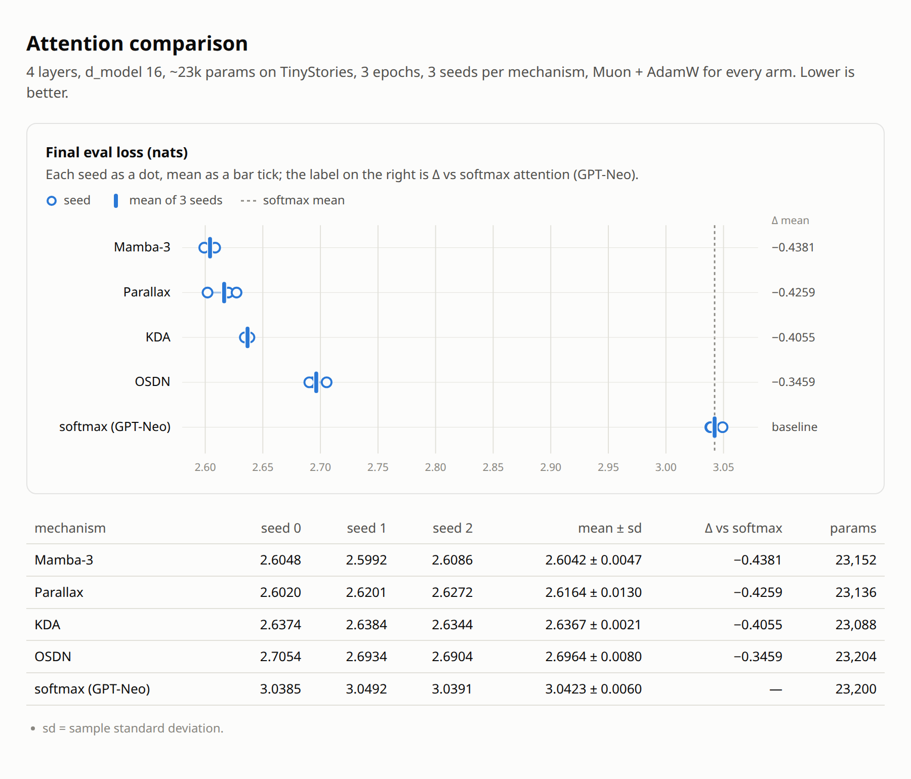

# attention_comparison

Which attention mechanism learns best at a fixed budget of ~23k parameters?
One model, one dataset and one training protocol; only the attention layer
changes. Each layer is the full layer that its paper proposes.

## Setup

Shared by every arm:

| | |
|---|---|
| data | TinyStories (revision `f54c09f`), BPE vocab 512 |
| model | 4 blocks, d_model 16, MLP width 64 (gelu_new), tied embeddings |
| context_length | 128 |
| training | 3 epochs, batch 1024, cosine schedule with 500 warmup steps, grad clip 1.0, fp32 |
| optimizer | Muon (lr 0.02) on 2-D matmul weights, AdamW (lr 5e-4, weight decay 0.01) on the rest |
| seeds | 0, 1, 2 |

Per arm:

| attention | (n_heads, head_dim) | params |
|---|---|---|
| softmax | (4, 4) | 23200 |
| KDA | (4, 4) | 23088 |
| OSDN | (4, 5) | 23204 |
| Parallax | (2, 12) | 23136 |
| Mamba-3 | (4, 3), state size 16 | 23152 |

Each arm package has a `check.py` that compares the layer with a
token-by-token reference of its paper's equations.

## Results

Eval loss (nats), 3 seeds, mean ± sample-stdev:

| attention | seed 0 | seed 1 | seed 2 | mean ± std | params |
|---|---|---|---|---|---|
| Mamba-3 | 2.6048 | 2.5992 | 2.6086 | 2.6042 ± 0.0047 | 23152 |
| Parallax | 2.6020 | 2.6201 | 2.6272 | 2.6164 ± 0.0130 | 23136 |
| KDA | 2.6374 | 2.6384 | 2.6344 | 2.6367 ± 0.0021 | 23088 |
| OSDN | 2.7054 | 2.6934 | 2.6904 | 2.6964 ± 0.0080 | 23204 |
| softmax | 3.0385 | 3.0492 | 3.0391 | 3.0423 ± 0.0060 | 23200 |

- **softmax** — GPT-Neo attention: global and local (window 16) layers
  alternate, learned absolute positions.
- **KDA** — Kimi Team, "Kimi Linear: An Expressive, Efficient Attention
  Architecture," [arXiv:2510.26692](https://arxiv.org/abs/2510.26692).
- **OSDN** — Zhou, Li, Liu, Lin, Ge, Ye, "Improving Delta Rule with Provable
  Online Preconditioning in Linear Attention,"
  [arXiv:2605.13473](https://arxiv.org/abs/2605.13473).
- **Parallax** — Zuo, Pai, Zeng, Dewulf, Hu, Wang, "Parallax: Parameterized
  Local Linear Attention," [arXiv:2605.29157](https://arxiv.org/abs/2605.29157).
- **Mamba-3** — Lahoti, Li, Chen, Wang, Bick, Kolter, Dao, Gu, "Mamba-3:
  Improved Sequence Modeling using State Space Principles,"
  [arXiv:2603.15569](https://arxiv.org/abs/2603.15569).
